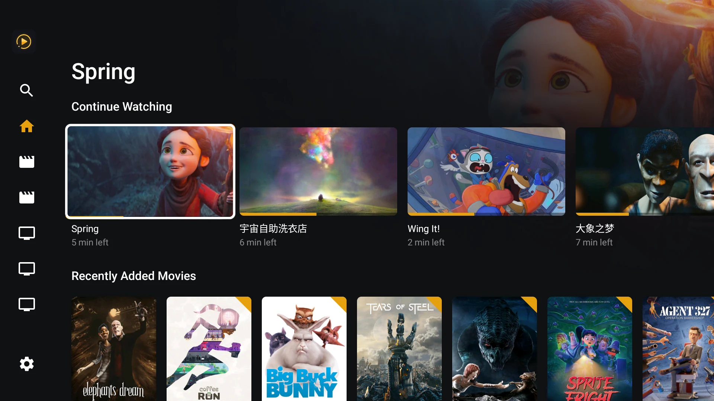
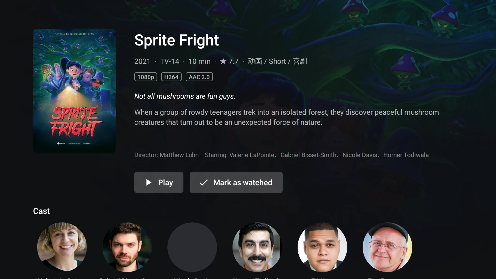
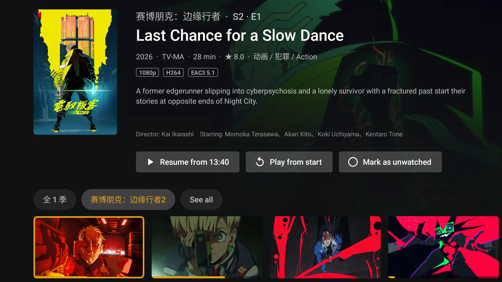
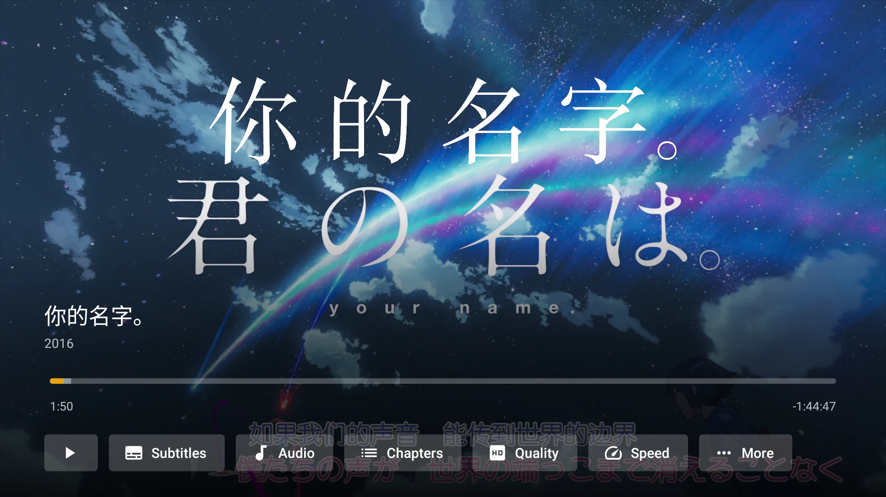
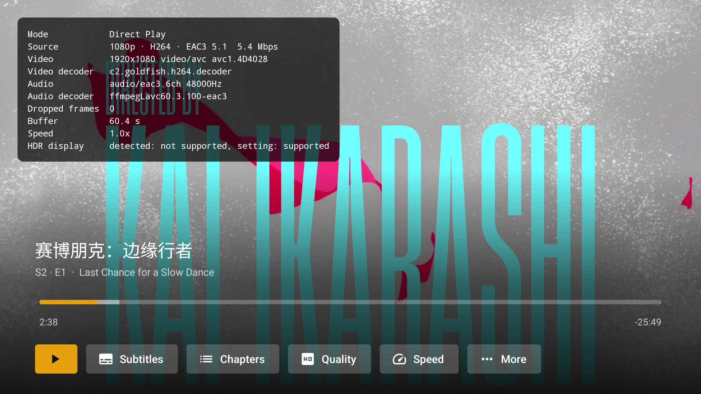
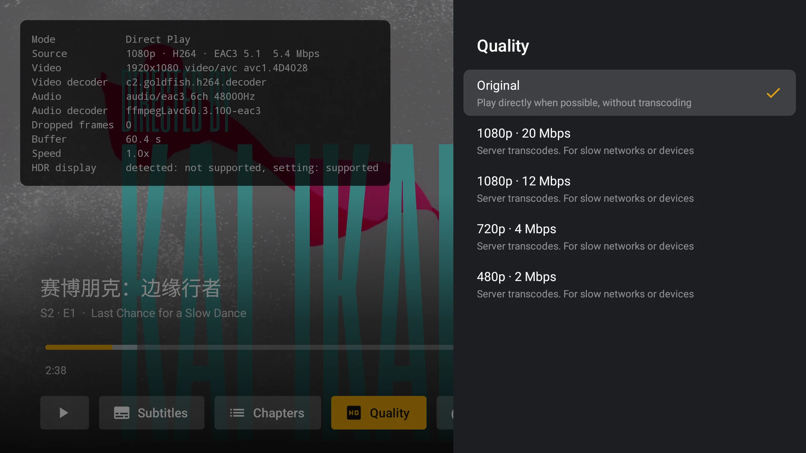
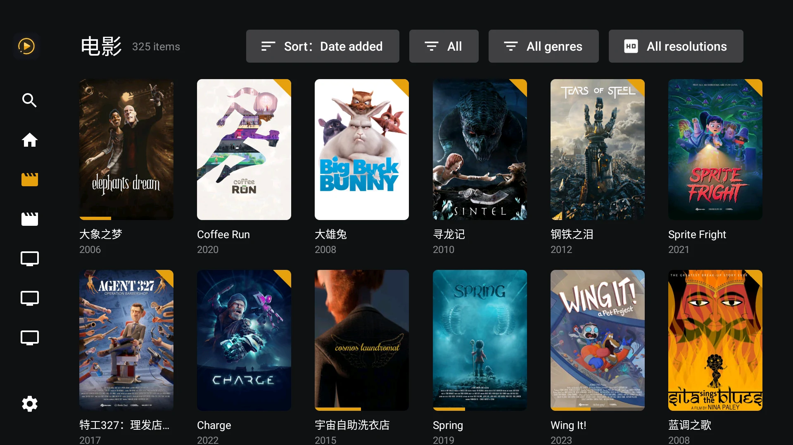
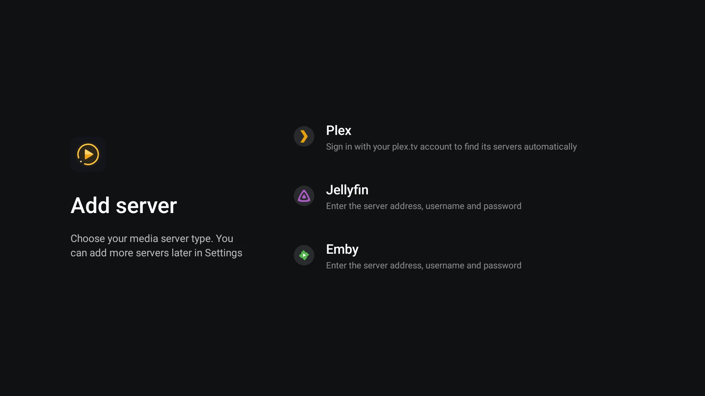

# Lumy Player

English | [简体中文](README.zh-CN.md)

[](https://github.com/hesier/lumy-player/actions/workflows/ci.yml)
[](https://github.com/hesier/lumy-player/releases/latest)
[](LICENSE)


A remote-friendly media client for Android TV, Android boxes and projectors, with support for Plex, Jellyfin and Emby.

<p align="center"></p>

## Features

- **Sign-in and servers**
  - Plex: sign in with a plex.tv PIN, discover the servers on your account, and probe for a reachable address (local / remote / relay), reconnecting automatically when the connection drops
  - Jellyfin / Emby: sign in with server address, username and password (a bare IP defaults to http and port 8096), or scan a QR code and type them on your phone
  - HTTPS servers with Let's Encrypt certificates also work on Android 5.0–7.0, whose built-in trust store is too old (see [TLS compatibility](docs/tls-compatibility.md))
  - Add multiple servers (even the same server more than once), switch between them at the top of the sidebar, and rename or remove them in Settings
- **Browsing**: home hubs (Continue Watching, Recently Added, …), library grids with filters, sorting and an A–Z index, search, collections, playlists, cast filmographies and "More Like This"
- **Details**: movies, shows, seasons and episodes, version selection, mark as watched / unwatched
- **Playback** (Media3 / ExoPlayer)
  - Direct play or server-side HLS transcoding based on the device's decoder capabilities, with optional quality / bitrate limits; HDR, Dolby Vision and passthrough support (see [Playback and Decoding](docs/playback.md))
  - FFmpeg audio decoder extension and audio passthrough (AC3 / DTS to your receiver)
  - Local rendering of styled ASS / SSA subtitles (libass), avoiding server-side burn-in where possible
  - Multi-part files, chapters, intro skipping, auto-play next episode
  - Audio / subtitle delay adjustment, refresh-rate matching
  - Remembers audio and subtitle choices, reports progress to the server
- **Settings**: default quality, allow / disallow transcoding, subtitle size, sidebar items and order (saved per server), server management and more
- **Languages**: English, Simplified Chinese and Traditional Chinese, following the system language or chosen in Settings

## Screenshots

<table>
  <tr>
    <td><br><sub>Movie details</sub></td>
    <td><br><sub>Episode details</sub></td>
  </tr>
  <tr>
    <td><br><sub>Player controls</sub></td>
    <td><br><sub>Playback info: direct play with FFmpeg audio decoding</sub></td>
  </tr>
  <tr>
    <td><br><sub>Quality and transcoding</sub></td>
    <td><br><sub>Skip intro</sub></td>
  </tr>
  <tr>
    <td><br><sub>Library with filters and sorting</sub></td>
    <td><br><sub>Choose a server type</sub></td>
  </tr>
</table>

## Installation

Download `lumy-player-vX.Y.Z.apk` from the [latest release](https://github.com/hesier/lumy-player/releases/latest) and sideload it onto your TV, box or projector. Requires Android 5.0 or later on an ARM device.

APKs you build yourself are signed with a different key, so they cannot be installed over a release build (or vice versa). Uninstall the existing app first; your servers and settings will need to be set up again.

## Known limitations

- Only movie and TV show libraries are shown; music, photo and other library types are not supported yet
- No Live TV / DVR and no offline downloads
- Plex Home user switching and Jellyfin Quick Connect are not supported; sign in with the account you want to use
- Dolby Vision Profile 5 needs a device with a Dolby Vision decoder; otherwise the server has to transcode it (details in [Playback and Decoding](docs/playback.md#dolby-vision))
- ARM devices only (`armeabi-v7a` / `arm64-v8a`)
- Phone input needs the phone and TV on the same LAN. If the page does not open, turn off the phone's VPN and check guest Wi-Fi / AP isolation; on a TV with several network connections, disconnect the unused ones

## Privacy

Lumy Player has no analytics or tracking. It only connects to the servers you add, plus plex.tv for Plex sign-in and server discovery.

Phone input is served by the TV itself, with no relay or third-party resources. Each QR code is valid for five minutes and accepts one submission, and the TV stops listening as soon as the dialog closes or the app goes to the background. The phone sends the details to the TV over plain local HTTP, so use it only on a network you trust.

## Development requirements

- JDK 17
- Android SDK (compileSdk / targetSdk 35)
- Device: Android 5.0 (API 21) or later, ARM (`armeabi-v7a` / `arm64-v8a`)

## Build and install

```bash
./gradlew :app:assembleDebug
```

```bash
./gradlew :app:installDebug
```

Release build:

```bash
./gradlew :app:assembleRelease
```

To sign it with your own key, put the keystore and a `keystore.properties` file in `.local/` at the project root (the whole directory is git-ignored):

```properties
storeFile=release.jks
storePassword=...
keyAlias=lumy
keyPassword=...
```

`storeFile` is relative to `.local/`. The same values can also come from the environment variables `LUMY_KEYSTORE_FILE`, `LUMY_KEYSTORE_PASSWORD`, `LUMY_KEY_ALIAS` and `LUMY_KEY_PASSWORD` (useful in CI; `LUMY_KEYSTORE_FILE` is relative to the project root). Without either, the release build falls back to the debug key, which is fine for sideloading but not for distribution.

Run the unit tests (core, net and server modules, plain JVM):

```bash
./gradlew :core:test :net:test :server-plex:test :server-jellyfin:test
```

### Publishing a release

Pushing a tag `v<versionName>` (e.g. `v0.1.0`) runs [release.yml](.github/workflows/release.yml), which builds a signed APK and attaches it to a GitHub release. The release notes come from that version's section in [CHANGELOG.md](CHANGELOG.md) and [CHANGELOG.zh-CN.md](CHANGELOG.zh-CN.md), and the workflow fails if either is missing. It needs these repository secrets:

| Secret | Value |
|---|---|
| `RELEASE_KEYSTORE_BASE64` | `base64 -i .local/release.jks` |
| `RELEASE_KEYSTORE_PASSWORD` | keystore password |
| `RELEASE_KEY_ALIAS` | key alias |
| `RELEASE_KEY_PASSWORD` | key password |

## Project structure

```
core/            Plain Kotlin: media models and the MediaServer interface, independent of any server
net/             Plain Kotlin: the LAN receiver for phone input and the extra TLS trust roots for older Android
server-plex/     Plain Kotlin: Plex account, server discovery, connection probing and API (OkHttp + kotlinx.serialization)
server-jellyfin/ Plain Kotlin: Jellyfin and Emby sign-in and API (same API family, auth headers chosen by ServerKind)
app/             Android app: UI (View + RecyclerView, no Leanback / Compose) and the player
```

`app` talks to servers only through the `MediaServer` interface in `core`; the server modules do not depend on each other.

## Contributing

See [CONTRIBUTING.md](CONTRIBUTING.md). Pre-built APKs are available on the [Releases](https://github.com/hesier/lumy-player/releases) page.

## Acknowledgments

Lumy Player is built on these open-source projects:

- [AndroidX Media3 / ExoPlayer](https://github.com/androidx/media) — playback engine (Apache-2.0)
- [jellyfin-androidx-media](https://github.com/jellyfin/jellyfin-androidx-media) — prebuilt Media3 FFmpeg audio decoder extension (GPL-3.0), which bundles [FFmpeg](https://ffmpeg.org)
- [libass-android / ass-media](https://github.com/peerless2012/libass-android) — ASS / SSA subtitle rendering for Media3 (MIT), built on [libass](https://github.com/libass/libass) (ISC)
- [OkHttp](https://github.com/square/okhttp), [kotlinx.serialization](https://github.com/Kotlin/kotlinx.serialization), [kotlinx.coroutines](https://github.com/Kotlin/kotlinx.coroutines) and [Coil](https://github.com/coil-kt/coil) (Apache-2.0)
- [ZXing](https://github.com/zxing/zxing) — QR code generation (Apache-2.0)

## License

Lumy Player is released under the [GNU General Public License v3.0](LICENSE).

Lumy Player is not affiliated with Plex Inc., the Jellyfin project or Emby. All names and trademarks belong to their respective owners.
