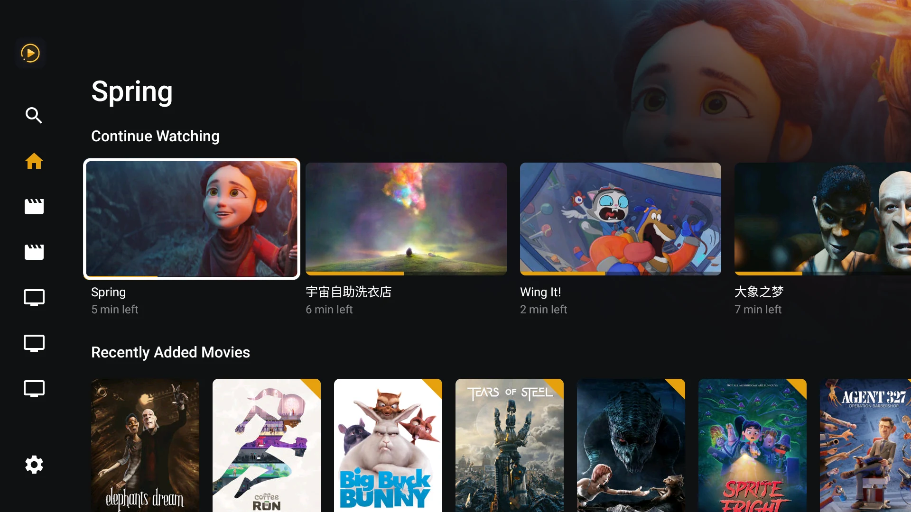
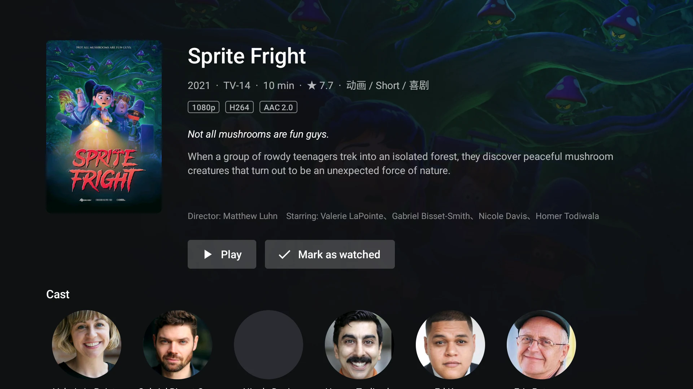
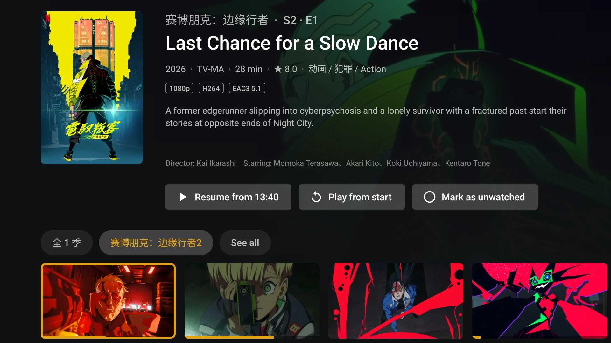
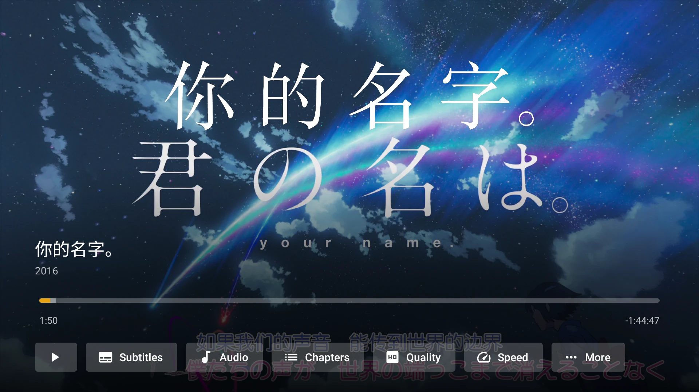
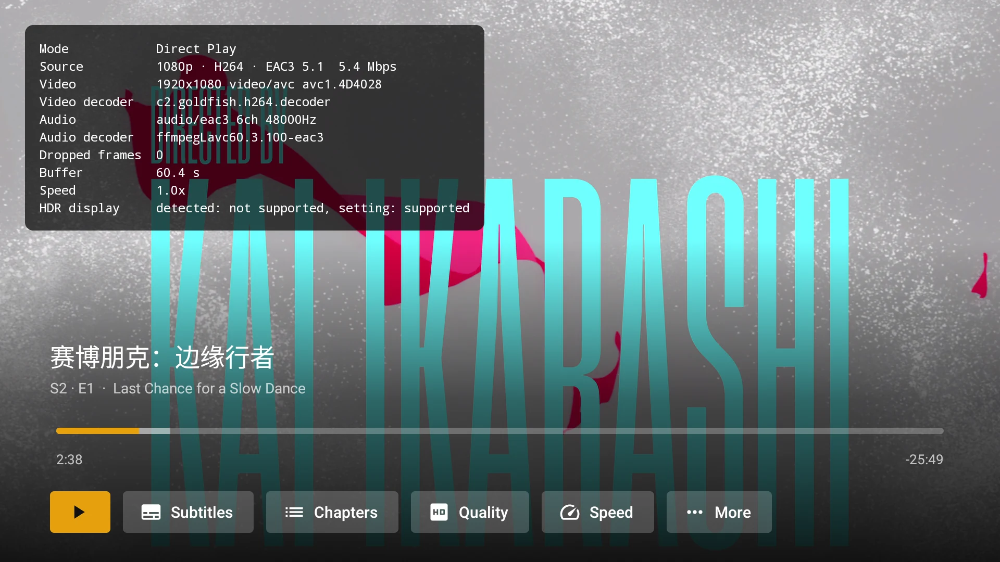
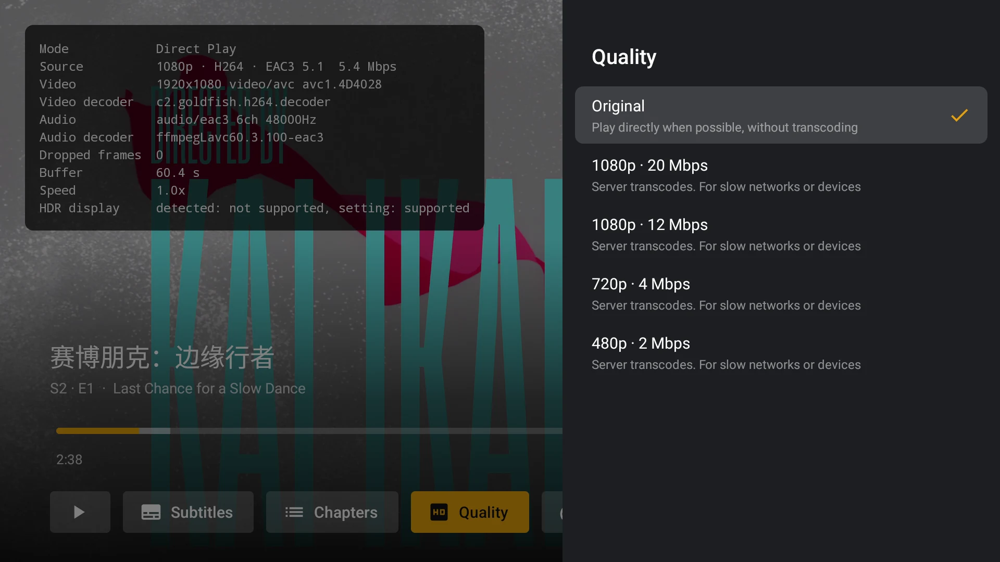
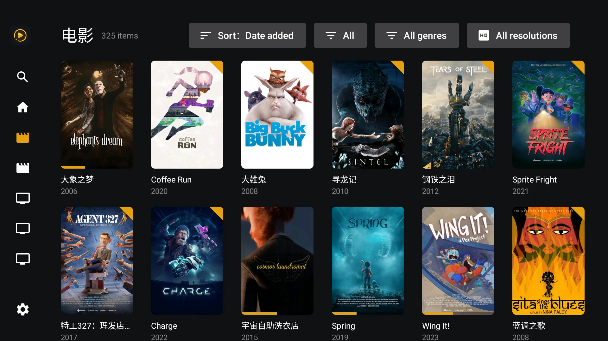
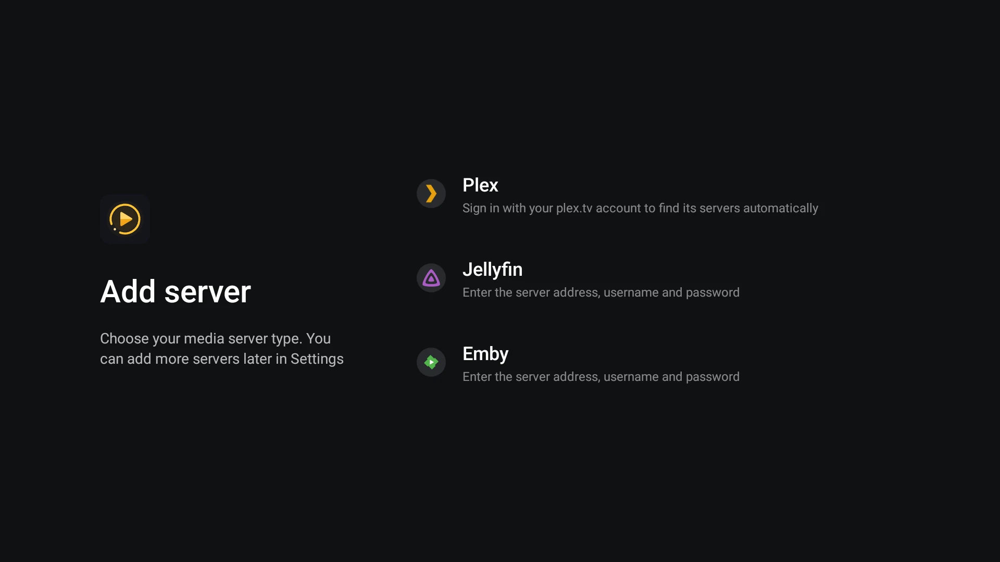

# Lumy Player

English | [简体中文](README.zh-CN.md)

[](https://github.com/hesier/lumy-player/actions/workflows/ci.yml)
[](https://github.com/hesier/lumy-player/releases/latest)
[](LICENSE)


A remote-friendly media client for Android TV, Android boxes and projectors, with support for Plex, Jellyfin, Emby and fnOS Media.

<p align="center"></p>

## Features

- **Sign-in and servers**
  - Plex: sign in with a plex.tv PIN, discover the servers on your account, and probe for a reachable address (local / remote / relay), reconnecting automatically when the connection drops
  - Jellyfin / Emby: sign in with server address, username and password (a bare IP defaults to http and port 8096), or scan a QR code and type them on your phone
  - fnOS Media: sign in with server address, media account and password (a bare IP defaults to http and port 8005)
  - HTTPS servers with Let's Encrypt certificates also work on Android 5.0–7.0, whose built-in trust store is too old (see [TLS compatibility](docs/tls-compatibility.md))
  - Add multiple servers (even the same server more than once), switch between them at the top of the sidebar, and rename or remove them in Settings
- **Browsing**: home hubs (Continue Watching, Recently Added, …), library grids with filters, sorting and an A–Z index, search, collections, playlists, cast filmographies and "More Like This"
- **Details**: movies, shows, seasons and episodes, version selection, mark as watched / unwatched
- **Favorites**: server-synced movie, show and episode favorites for Jellyfin, Emby and fnOS Media, with a dedicated sidebar page
- **Playback** (Media3 / ExoPlayer)
  - Direct play or server-side HLS transcoding based on the device's decoder capabilities, with optional quality / bitrate limits; HDR, Dolby Vision and passthrough support (see [Playback and Decoding](docs/playback.md))
  - FFmpeg audio decoder extension and audio passthrough (AC3 / DTS to your receiver)
  - Local rendering of styled ASS / SSA subtitles (libass), avoiding server-side burn-in where possible
  - Dual subtitles via More → Secondary subtitles; smaller secondary text below the primary, with original ASS / bitmap layouts preserved
  - Multi-part files, chapters, intro skipping, auto-play next episode
  - Audio / subtitle delay adjustment, refresh-rate matching
  - Remembers audio and subtitle choices, reports progress to the server
- **Danmaku**: DandanPlay (requires a configured proxy), custom compatible APIs and Jellyfin / Emby plugins, with automatic / manual matching, remembered choices, offline cache reuse and display settings. Off by default; see [playback guidance](docs/playback.md)
- **TV home screen**: Continue Watching and next-episode cards on compatible Android TV launchers, with account-aware resume, media version and playlist context. Settings › Interface provides a switch, refresh and clear actions.
- **Settings**: default quality, per-server transcoding and available bandwidth, subtitle size, sidebar items and order (saved per server), server management and more
- **Backup and restore**: Settings › About › Backup and restore saves settings, servers with login sessions, and track selections to a `.lumy` file. Leave the backup password empty to save without encryption, or set a password to encrypt it. Transfer it using a phone on the same LAN or the system file picker / USB drive. Restore is also available on the initial server setup screen. Preview and choose what to replace; device-specific settings are excluded from restoration by default. Keep any password you set: it cannot be recovered. Expired login sessions still require signing in again.
- **Languages**: English, Simplified Chinese and Traditional Chinese, following the system language or chosen in Settings

File / USB backup transfer requires a system document picker. Some TV systems only provide a placeholder; use phone transfer on these devices.

See the [server support matrix](docs/server-support.md) for differences between integrations.

## Screenshots

<table>
  <tr>
    <td><br><sub>Movie details</sub></td>
    <td><br><sub>Episode details</sub></td>
  </tr>
  <tr>
    <td><br><sub>Player controls</sub></td>
    <td><br><sub>Playback info: direct play with FFmpeg audio decoding</sub></td>
  </tr>
  <tr>
    <td><br><sub>Quality and transcoding</sub></td>
    <td><br><sub>Skip intro</sub></td>
  </tr>
  <tr>
    <td><br><sub>Library with filters and sorting</sub></td>
    <td><br><sub>Choose a server type</sub></td>
  </tr>
</table>

## Installation

Download `lumy-player-vX.Y.Z.apk` from the [latest release](https://github.com/hesier/lumy-player/releases/latest) and sideload it onto your TV, box or projector. Requires Android 5.0 or later on an ARM device.

Later versions can be installed from inside the app: it checks for a new release once a day (Settings › About also has Check for updates), downloads it and opens the system installer. The first time, Android asks you to allow Lumy to install apps. If GitHub is slow or blocked on your network, turn on Download mirror in the same section.

APKs you build yourself are signed with a different key, so they cannot be installed over a release build (or vice versa). Export a backup before uninstalling, then restore it after installing the other build.

## Known limitations

- Only movie and TV show libraries are shown; music, photo and other library types are not supported yet
- No Live TV / DVR and no offline downloads
- Plex Home user switching and Jellyfin Quick Connect are not supported; sign in with the account you want to use
- fnOS Media does not yet support collections, playlists, cast filmographies or recommendations; transcoding does not support video stream copy or 7.1 audio output
- Dolby Vision Profile 5 prefers native playback and can try HEVC compatibility playback if unavailable or failing, but colors may be incorrect. Correct output still requires a compatible Dolby Vision chain (details in [Playback and Decoding](docs/playback.md#dolby-vision))
- ARM devices only (`armeabi-v7a` / `arm64-v8a`)
- Phone input needs the phone and TV on the same LAN. If the page does not open, turn off the phone's VPN and check guest Wi-Fi / AP isolation; on a TV with several network connections, disconnect the unused ones

## Privacy

Lumy Player has no analytics or tracking. It only connects to the servers you add, plus plex.tv for Plex sign-in and server discovery.

Phone input is served by the TV itself, with no relay or third-party resources. Each QR code is valid for five minutes and accepts one submission, and the TV stops listening as soon as the dialog closes or the app goes to the background. The phone sends the details to the TV over plain local HTTP, so use it only on a network you trust.

## Development requirements

- JDK 17
- Android SDK (compileSdk / targetSdk 35)
- Device: Android 5.0 (API 21) or later, ARM (`armeabi-v7a` / `arm64-v8a`)

## Build and install

```bash
./gradlew :app:assembleDebug
```

```bash
./gradlew :app:installDebug
```

Release build:

```bash
./gradlew :app:assembleRelease
```

To sign it with your own key, put the keystore and a `keystore.properties` file in `.local/` at the project root (the whole directory is git-ignored):

```properties
storeFile=release.jks
storePassword=...
keyAlias=lumy
keyPassword=...
```

`storeFile` is relative to `.local/`. The same values can also come from the environment variables `LUMY_KEYSTORE_FILE`, `LUMY_KEYSTORE_PASSWORD`, `LUMY_KEY_ALIAS` and `LUMY_KEY_PASSWORD` (useful in CI; `LUMY_KEYSTORE_FILE` is relative to the project root). Without either, the release build falls back to the debug key, which is fine for sideloading but not for distribution.

Run the unit tests (core, net and server modules, plain JVM):

```bash
./gradlew :core:test :net:test :server-plex:test :server-jellyfin:test :server-fnos:test
```

### Publishing a release

Pushing a tag `v<versionName>` (e.g. `v0.1.0`) runs [release.yml](.github/workflows/release.yml), which builds a signed APK and attaches it to a GitHub release. The release notes come from that version's section in [CHANGELOG.md](CHANGELOG.md) and [CHANGELOG.zh-CN.md](CHANGELOG.zh-CN.md), and the workflow fails if either is missing. The workflow also uploads `update.json` (version, APK checksum and the notes in each language), which the in-app updater reads from the latest release. The tagged commit must already be on `main`. It needs these repository secrets:

| Secret | Value |
|---|---|
| `RELEASE_KEYSTORE_BASE64` | `base64 -i .local/release.jks` |
| `RELEASE_KEYSTORE_PASSWORD` | keystore password |
| `RELEASE_KEY_ALIAS` | key alias |
| `RELEASE_KEY_PASSWORD` | key password |

To enable DandanPlay in the published APK, also configure `DANMAKU_PROXY_URL` and `DANMAKU_PROXY_TOKEN` as repository secrets. The token must match the deployed Worker's `PROXY_TOKEN`; see the [proxy setup and deployment guide](services/danmaku-worker/README.md). Both values must be configured together: omitting both leaves the official source unavailable, while setting only one fails the build. Official AppSecret and Cloudflare deployment credentials stay on the server and are not needed by the app release workflow.

## Project structure

```
core/            Plain Kotlin: media models and the MediaServer interface, independent of any server
net/             Plain Kotlin: the LAN receiver for phone input, the extra TLS trust roots for older Android and the update checker
server-plex/     Plain Kotlin: Plex account, server discovery, connection probing and API (OkHttp + kotlinx.serialization)
server-jellyfin/ Plain Kotlin: Jellyfin and Emby sign-in and API (same API family, auth headers chosen by ServerKind)
server-fnos/     Plain Kotlin: fnOS Media sign-in, native APIs and compatibility endpoints
app/             Android app: UI (View + RecyclerView, no Leanback / Compose) and the player
```

`app` talks to servers only through the `MediaServer` interface in `core`; the server modules do not depend on each other.

## Contributing

See [CONTRIBUTING.md](CONTRIBUTING.md). Pre-built APKs are available on the [Releases](https://github.com/hesier/lumy-player/releases) page.

## Acknowledgments

Lumy Player is built on these open-source projects:

- [AndroidX Media3 / ExoPlayer](https://github.com/androidx/media) — playback engine (Apache-2.0)
- [jellyfin-androidx-media](https://github.com/jellyfin/jellyfin-androidx-media) — Media3 FFmpeg audio decoder extension (GPL-3.0), which bundles [FFmpeg](https://ffmpeg.org); Lumy uses a [patched ARM build](third_party/media3-ffmpeg/README.md) for TrueHD initialization
- [libass-android / ass-media](https://github.com/peerless2012/libass-android) — ASS / SSA subtitle rendering for Media3 (MIT), built on [libass](https://github.com/libass/libass) (ISC)
- [OkHttp](https://github.com/square/okhttp), [kotlinx.serialization](https://github.com/Kotlin/kotlinx.serialization), [kotlinx.coroutines](https://github.com/Kotlin/kotlinx.coroutines) and [Coil](https://github.com/coil-kt/coil) (Apache-2.0)
- [ZXing](https://github.com/zxing/zxing) — QR code generation (Apache-2.0)

## License

Lumy Player is released under the [GNU General Public License v3.0](LICENSE).

Lumy Player is not affiliated with Plex Inc., the Jellyfin project or Emby. All names and trademarks belong to their respective owners.
