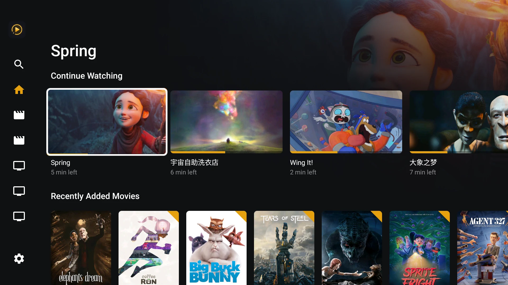
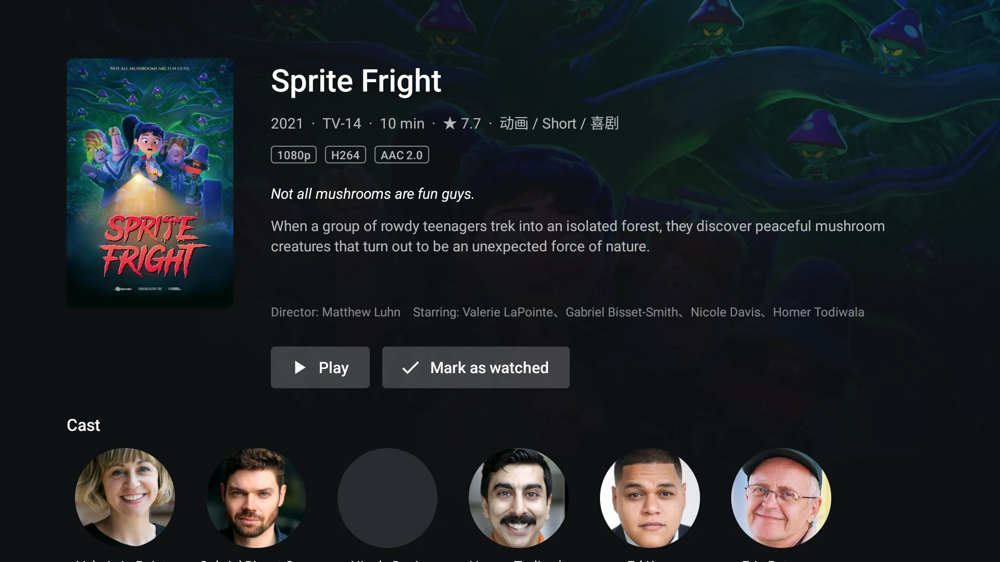
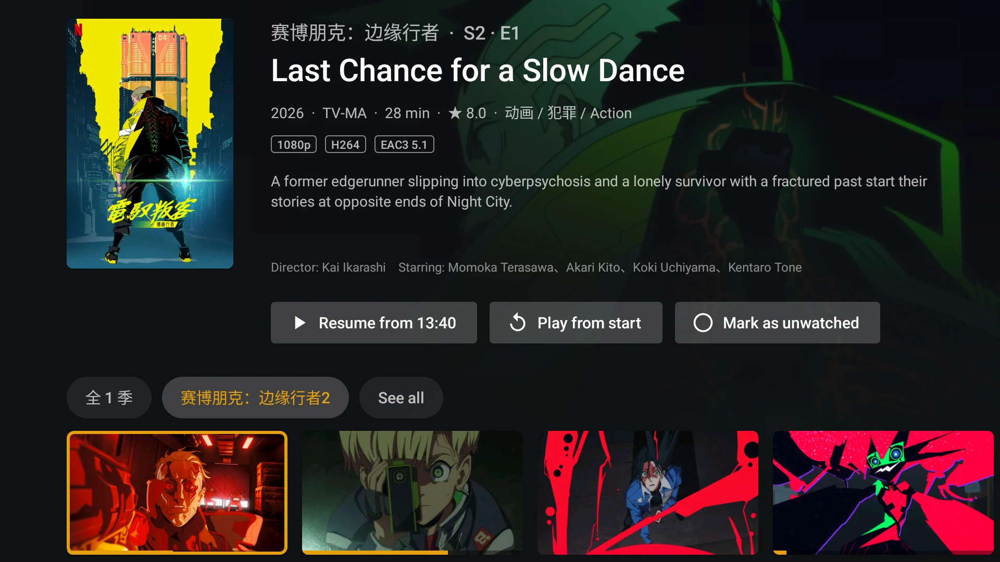
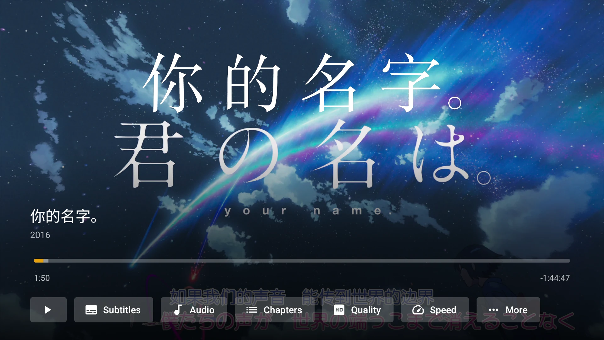
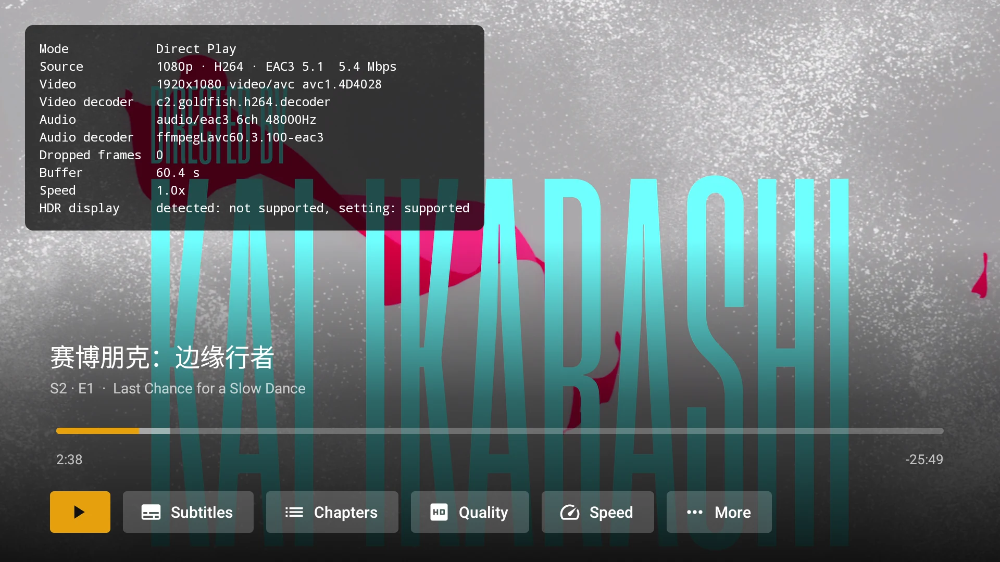
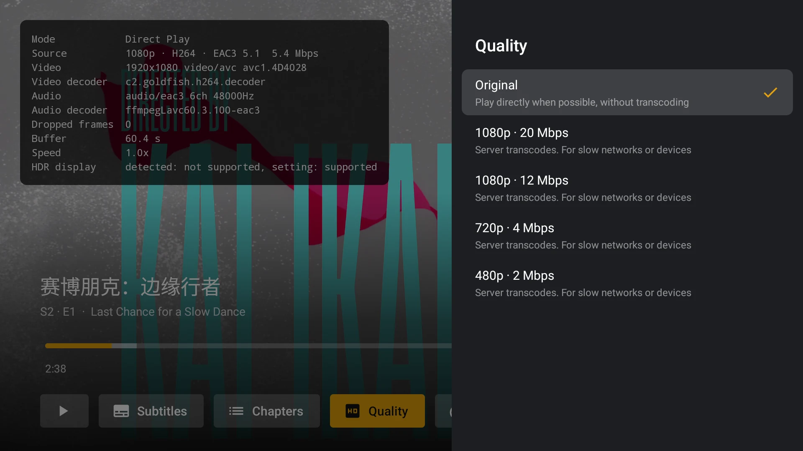
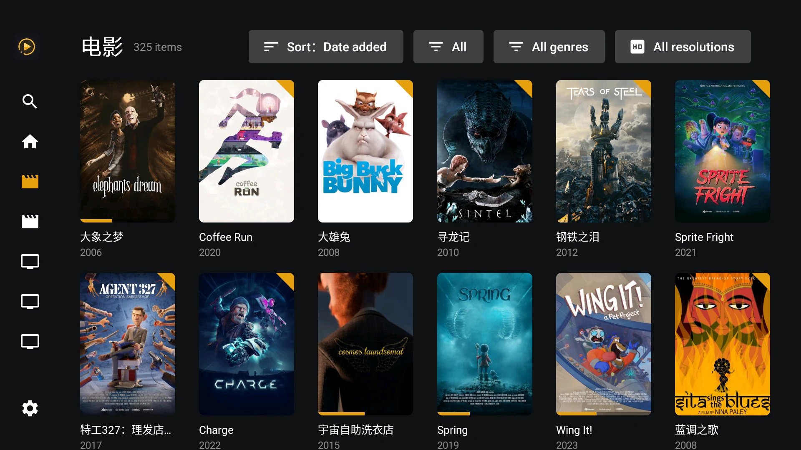
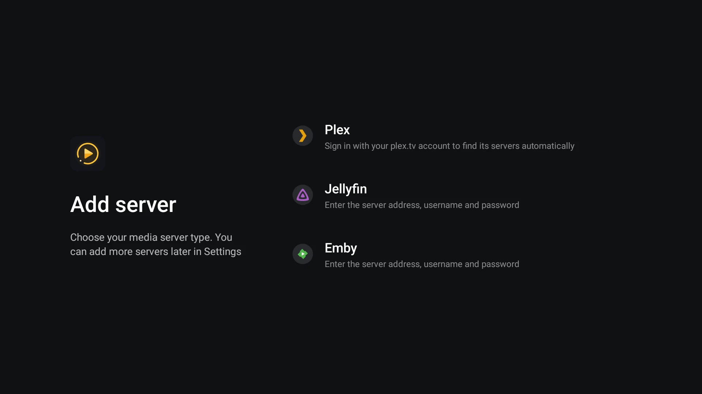

# Lumy Player

[English](README.md) | 简体中文

[](https://github.com/hesier/lumy-player/actions/workflows/ci.yml)
[](https://github.com/hesier/lumy-player/releases/latest)
[](LICENSE)


一个面向 Android TV、安卓盒子和投影仪的媒体客户端，支持 Plex、Jellyfin、Emby 和飞牛影视，用遥控器操作。

<p align="center"></p>

## 功能

- **登录与服务器**
  - Plex：plex.tv PIN 码登录，自动发现账号下的服务器并探测可用地址（局域网 / 远程 / 中继），连不上时自动重连
  - Plex Home：支持家庭成员切换及 PIN 验证，默认自动进入上次用户，可在「设置 → 服务器」中关闭；关闭后清空并暂停 Plex 系统桌面继续观看卡片，重新开启后按桌面继续观看开关恢复同步
  - Jellyfin / Emby：输入服务器地址、用户名和密码登录（只填 IP 时默认 http 和端口 8096），也可以扫码在手机上填写；Jellyfin 还支持服务端开启后的 Quick Connect 配对登录
  - 飞牛影视：输入服务器地址、影视独立账号和密码登录（只填 IP 时默认 http 和端口 8005）
  - Android 5.0–7.0 的系统证书库较旧，也能连接使用 Let's Encrypt 证书的 HTTPS 服务器（见 [TLS 兼容说明](docs/tls-compatibility.zh-CN.md)）
  - 可以添加多台服务器（同一台服务器也可以添加多次），在侧边栏顶部切换，在设置里重命名、删除
- **浏览**：首页推荐行（继续观看、最近添加等）、媒体库网格（筛选、排序、首字母索引）、搜索、合集、播放列表、演员作品、更多类似
- **详情页**：影片 / 剧集 / 季 / 集，多版本选择，标记已看 / 未看
- **收藏**：Jellyfin、Emby 和飞牛影视支持电影、节目和单集收藏，与服务器同步，侧栏提供独立收藏页
- **播放**（Media3 / ExoPlayer）
  - 按本机解码能力决定直接播放或让服务器转码为 HLS，可限制画质 / 码率；HDR、杜比视界、音频直通的支持情况见[播放与解码支持](docs/playback.zh-CN.md)
  - FFmpeg 音频解码扩展、音频直通（AC3 / DTS 交给功放）
  - 本地渲染 ASS / SSA 特效字幕（libass），尽量避免服务器烧录字幕
  - 在“更多 → 副字幕”开启双字幕；普通文本副字幕字号稍小，排在主字幕下方，ASS / 图形字幕保留原始排版
  - 多段文件、章节、跳过片头、自动下一集
  - 音画 / 字幕延迟调整、刷新率匹配
  - 记住音轨与字幕选择，进度上报给服务器
- **弹幕**：支持弹弹 Play（需配置代理）、自定义兼容 API 和 Jellyfin / Emby 插件，提供自动 / 手动匹配、选择记忆、缓存离线复用和显示设置，默认关闭，详见[播放说明](docs/playback.zh-CN.md)
- **设置**：默认画质、按服务器保存的转码开关及可用带宽、字幕大小、侧边栏显示项和顺序（每台服务器分开保存）、服务器管理等

各服务器的功能差异见[服务器功能支持对照](docs/server-support.zh-CN.md)。

## 截图

<table>
  <tr>
    <td><br><sub>电影详情</sub></td>
    <td><br><sub>单集详情</sub></td>
  </tr>
  <tr>
    <td><br><sub>播放控制</sub></td>
    <td><br><sub>播放信息：直接播放 + FFmpeg 音频解码</sub></td>
  </tr>
  <tr>
    <td><br><sub>画质与转码</sub></td>
    <td><br><sub>跳过片头</sub></td>
  </tr>
  <tr>
    <td><br><sub>媒体库（筛选与排序）</sub></td>
    <td><br><sub>选择服务器类型</sub></td>
  </tr>
</table>

## 安装

从 [最新 Release](https://github.com/hesier/lumy-player/releases/latest) 下载 `lumy-player-vX.Y.Z.apk`，侧载到电视、盒子或投影仪上即可。需要 Android 5.0 及以上的 ARM 设备。

之后的版本可以在应用内更新：每天检查一次新版本（设置 › 关于 里也可以手动检查更新），下载后打开系统安装界面。第一次安装时 Android 会要求允许 Lumy 安装应用。GitHub 很慢或打不开时，在同一处打开“下载镜像”。

自己编译的 APK 签名不同，不能覆盖安装 Release 版本（反之亦然）。卸载前可在“设置 › 关于 › 备份与恢复”导出备份，安装后恢复。

备份包含应用设置、服务器及登录状态、侧栏设置和轨道记忆，以 `.lumy` 文件保存；密码可留空，填写密码时才加密。可用同一局域网内的手机扫码传输，也可通过系统文件选择器存取文件或 U 盘。首次添加服务器的页面也有恢复入口。恢复前可预览并选择覆盖范围，默认保留当前设备相关设置。如设置密码，请保存好，密码无法找回；已失效的登录状态仍需重新登录。

文件 / U 盘传输需要系统提供文件选择器。部分 TV 系统仅有占位程序，这类设备请使用手机扫码传输。

## 已知限制

- 只显示电影和剧集媒体库，暂不支持音乐、照片等其他类型
- 不支持直播电视 / DVR，不支持离线下载
- 飞牛影视暂未接入合集和播放列表；演员作品已接入原生分页，相关推荐按演员 / 流派元数据在本地推导。待看下一集根据返回的单集播放记录，查找当前继续观看剧集等锚点之后的下一未看集；服务端移除已完成历史后无法还原完整追剧队列。转码暂不支持视频流复制和 7.1 音频输出
- Jellyfin / Emby 首字母索引仅用于标题排序，按相同筛选条件分页获取轻量数据并在本地统计；超过 100,000 条时不提供索引。缓存和验证边界见[功能支持对照](docs/server-support.zh-CN.md)
- 杜比视界 Profile 5 优先原生播放；不支持或失败时可尝试 HEVC 兼容播放，但颜色可能不正确。正确色彩仍需要支持对应 DV profile 的完整输出链（详见[播放与解码支持](docs/playback.zh-CN.md#杜比视界)）
- 只支持 ARM 设备（`armeabi-v7a` / `arm64-v8a`）
- 手机扫码输入要求手机和电视在同一局域网。打不开网页时，请关闭手机 VPN，检查路由器的访客网络或 AP 隔离；电视连着多个网络时，断开用不到的那个

## 隐私

Lumy Player 不包含任何统计或追踪，只连接你添加的服务器，以及 Plex 登录、家庭用户切换和发现服务器时用到的 plex.tv。

手机扫码输入的网页由电视自己提供，不经过中转，也不加载第三方资源。每个二维码五分钟内有效、只接受一次提交，关闭窗口或应用切到后台就立即停止接收。手机通过局域网 HTTP 明文把信息发到电视，请只在可信的网络里使用。

## 开发环境

- JDK 17
- Android SDK（compileSdk / targetSdk 35）
- 设备：Android 5.0（API 21）及以上，ARM 架构（`armeabi-v7a` / `arm64-v8a`）

## 构建与安装

```bash
./gradlew :app:assembleDebug
```

```bash
./gradlew :app:installDebug
```

Release 包：

```bash
./gradlew :app:assembleRelease
```

要用自己的密钥签名，把密钥库和 `keystore.properties` 放在项目根目录的 `.local/` 里（整个目录已加入 `.gitignore`）：

```properties
storeFile=release.jks
storePassword=...
keyAlias=lumy
keyPassword=...
```

`storeFile` 相对于 `.local/`。也可以用环境变量 `LUMY_KEYSTORE_FILE`、`LUMY_KEYSTORE_PASSWORD`、`LUMY_KEY_ALIAS`、`LUMY_KEY_PASSWORD` 提供（方便 CI，`LUMY_KEYSTORE_FILE` 相对于项目根目录）。两者都没有时 release 包退回 debug 签名，只适合侧载测试，不能用于发布。

运行单元测试（core、net 和服务器模块，纯 JVM）：

```bash
./gradlew :core:test :net:test :server-plex:test :server-jellyfin:test :server-fnos:test
```

### 发布版本

推送 `v<versionName>` 格式的 tag（如 `v0.1.0`）会触发 [release.yml](.github/workflows/release.yml)，构建签名好的 APK 并上传到 GitHub Release。发布说明取自 [CHANGELOG.md](CHANGELOG.md) 和 [CHANGELOG.zh-CN.md](CHANGELOG.zh-CN.md) 里对应版本的那一节，任意一份缺少都会失败。工作流还会上传 `update.json`（版本号、APK 校验和、各语言的更新说明），应用内更新从最新 Release 读取它。打 tag 的提交必须已经合并进 `main`。需要在仓库里配置这些 secrets：

| Secret | 值 |
|---|---|
| `RELEASE_KEYSTORE_BASE64` | `base64 -i .local/release.jks` 的输出 |
| `RELEASE_KEYSTORE_PASSWORD` | 密钥库密码 |
| `RELEASE_KEY_ALIAS` | 密钥别名 |
| `RELEASE_KEY_PASSWORD` | 密钥密码 |

如需在发布的 APK 中启用弹弹 Play，还需配置 `DANMAKU_PROXY_URL` 和 `DANMAKU_PROXY_TOKEN` 两项仓库 Secrets。Token 必须与已部署 Worker 的 `PROXY_TOKEN` 一致，详见[代理配置与部署说明](services/danmaku-worker/README.md)。两项必须同时配置：均未配置时官方来源不可用，只配置一项则构建失败。官方 AppSecret 和 Cloudflare 部署凭据保留在服务端，App 发布工作流不需要它们。

## 项目结构

```
core/          纯 Kotlin：媒体模型和 MediaServer 接口，与具体服务器无关
net/           纯 Kotlin：手机扫码输入的局域网接收服务、旧版 Android 补充的 TLS 根证书、检查和下载新版本
server-plex/   纯 Kotlin：Plex 账号、服务器发现、连接探测和 API 实现（OkHttp + kotlinx.serialization）
server-jellyfin/ 纯 Kotlin：Jellyfin 和 Emby 的登录与 API 实现（两者接口同源，按 ServerKind 区分认证头）
server-fnos/     纯 Kotlin：飞牛影视登录、原生 API 与兼容接口实现
app/           Android 应用：界面（View + RecyclerView，无 Leanback/Compose）和播放器
```

`app` 只通过 `core` 的 `MediaServer` 接口访问服务器，各服务器模块互不依赖。

## 参与贡献

见 [CONTRIBUTING.md](CONTRIBUTING.md)（英文）。编译好的 APK 可以在 [Releases](https://github.com/hesier/lumy-player/releases) 页面下载。

## 致谢

Lumy Player 基于以下开源项目：

- [AndroidX Media3 / ExoPlayer](https://github.com/androidx/media)：播放引擎（Apache-2.0）
- [jellyfin-androidx-media](https://github.com/jellyfin/jellyfin-androidx-media)：预编译的 Media3 FFmpeg 音频解码扩展（GPL-3.0），内含 [FFmpeg](https://ffmpeg.org)
- [libass-android / ass-media](https://github.com/peerless2012/libass-android)：Media3 的 ASS / SSA 字幕渲染（MIT），基于 [libass](https://github.com/libass/libass)（ISC）
- [OkHttp](https://github.com/square/okhttp)、[kotlinx.serialization](https://github.com/Kotlin/kotlinx.serialization)、[kotlinx.coroutines](https://github.com/Kotlin/kotlinx.coroutines) 和 [Coil](https://github.com/coil-kt/coil)（Apache-2.0）
- [ZXing](https://github.com/zxing/zxing)：二维码生成（Apache-2.0）

## 许可证

本项目以 [GNU General Public License v3.0](LICENSE) 发布。

Lumy Player 与 Plex Inc.、Jellyfin 项目、Emby 均无关联，相关名称和商标归各自所有者。
